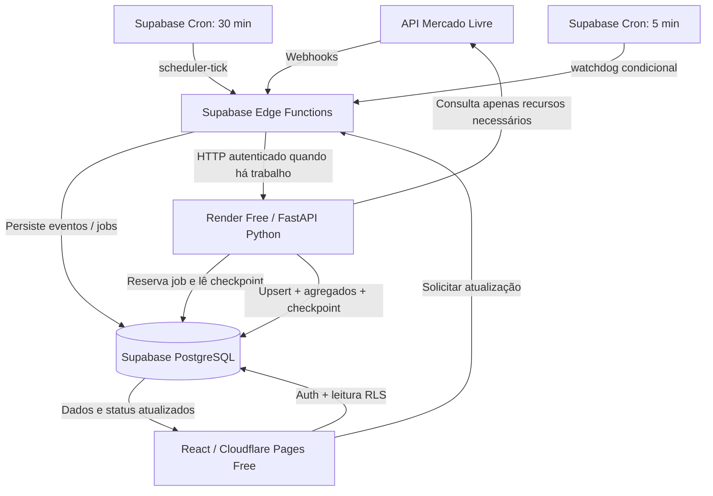

# MeliMetrics PRO — Escopo Final do MVP 1.0

**Versão do documento:** 1.1 — arquitetura cloud gratuita com Python no Render Free  
**Data:** 17/10/2026  
**Status:** escopo definido para implementação e **piloto técnico condicionado a testes**; integração real ainda não comprovada  
**Repositório:** https://github.com/Cesartcsd/MeliMetrics  
**Base de código avaliada:** `MeliMetrics-main.zip` fornecido na conversa; o HEAD remoto deve ser revisado antes de implementar.

---

## 1. Resumo executivo e decisões do MVP

**Missão:** permitir que um seller do Mercado Livre, sozinho ou com equipe, entenda **quanto vende, quanto efetivamente sobra, quais SKUs sustentam o resultado e quais problemas exigem ação**.

**Estratégia de produto:** uma plataforma multiempresa e multiusuário, com uso progressivo: poucos indicadores essenciais no início e análises profundas sob demanda. Preservar e conectar os módulos visuais existentes, sem manter ações fictícias na versão operacional.

**Restrição financeira prioritária:** **R$ 0 de custo contratado**, sem cartão de pagamento cadastrado no Render, sem upgrade ou serviços que possam cobrar automaticamente. Supabase e Cloudflare exclusivamente em planos Free. Uso acima das franquias pode provocar **limitação, hibernação ou suspensão**, não disponibilidade assegurada. Revisar os termos de cada conta antes de ativar o piloto.

**Decisões de infraestrutura:**

| Camada | Escolha para MVP 1.0 | Papel e limites |
|---|---|---|
| Frontend | React + TypeScript + Vite | Reutilizar o projeto atual e substituir mocks por contratos tipados |
| Hospedagem do site | **Cloudflare Pages Free, estático** | Não depender de recursos pagos ou Functions comerciais |
| Vercel | Opcional somente para demonstração pessoal não comercial no Hobby | Não integrar ao plano comercial gratuito |
| Login e permissões | **Supabase Auth + PostgreSQL RLS** | Isolamento por organização e papéis |
| Banco e consultas | **Supabase PostgreSQL + PostgREST/RPC** | Fatos mínimos rastreáveis e agregados rápidos |
| Receptores e orquestração | **Supabase Edge Functions (TypeScript/Deno)** | OAuth, webhook, criação de jobs e chamadas HTTP autenticadas |
| Agenda | **Supabase Cron (`pg_cron` + `pg_net`)** | Tick incremental a cada 30 min; verificação condicional a cada 5 min |
| Pipeline ETL | **Python 3 + FastAPI no Render Free (Web Service)** | Processamento em **requisições curtas e idempotentes**, não worker sempre ligado |
| Fila, progresso e deduplicação | **Tabelas PostgreSQL no Supabase** | Persistência após hibernação/reinício do Render |
| Leitura pela UI | Agregados Supabase com RLS; polling moderado de status | O frontend **nunca** consulta diretamente a API do Mercado Livre |
| GitHub Actions | **Apenas CI, testes e deploy** | **Não** usar como pipeline operacional recorrente |
| Componentes excluídos da fase | VPS, AWS com billing, Cloud Run com billing, Redis, Celery, worker pago, Render Cron Jobs pagos | Reavaliar somente após fim do piloto gratuito |

**Limite explícito:** o Render Free **não garante processamento 24/7**, nem execução pontual de cada job. O sistema deve **retomar trabalho com segurança** após hibernações/restarts, sinalizar atrasos e manter o dashboard legível mesmo sem atualização recente. Não vender a primeira versão como SaaS de alta disponibilidade.

**Piloto de referência:** **uma organização real, quatro contas Mercado Livre, cerca de 12.000 anúncios no total e 200–250 pedidos/dia agregados**; valores informados pelo usuário, não medidos em integração. Liberar mais sellers somente após mensurar consumo, tempo e qualidade dos dados.

## 2. Público e progressividade

### 2.1 Seller pequeno / médio

- Visualizar uma conta imediatamente após o primeiro carregamento válido.
- Encontrar GMV, vendas líquidas, margem de contribuição, pedidos e principais alertas.
- Cadastrar ou importar custo de aquisição por SKU sem planilhas complexas.
- Descobrir os produtos mais relevantes pela Curva ABC.
- Consultar a última atualização e solicitar uma nova sincronização.

### 2.2 Seller grande / gestor de equipe

- Alternar entre contas autorizadas e consultar visão consolidada.
- Filtrar por conta, período, SKU, anúncio (MLB), categoria e situação.
- Ver dados de várias lojas **sem misturar organizações distintas**.
- Delegar acesso por perfis mínimos: administrador, gestor e analista.
- Rastrear alterações de custo, disparos de atualização e falhas de integração.
- Exportar recortes autorizados para análise operacional.

### 2.3 Comportamento de interface progressiva

- **Modo inicial:** quatro áreas, indicadores essenciais e alertas prioritários.
- **Aprofundamento:** tabelas por produto/pedido, filtros avançados e drill-down.
- **Contexto unificado:** conta selecionada, intervalo de datas, timezone e status de atualização compartilhados entre telas.
- **Dados incompletos:** nenhum KPI de margem deve aparecer como valor definitivo quando há custo faltante ou componente pendente; informar cobertura de custo e estado da conciliação.

## 3. Navegação final e escopo dos módulos

### 3.1 Visão Geral — P0

**Obrigatório:** GMV, pedidos válidos, ticket médio, vendas líquidas, margem de contribuição calculável, ranking dos SKUs, evolução diária, resumo de alertas, último sucesso de sincronização e filtro global de conta/período.

**Regra:** todos os KPIs usam a mesma definição de período e a mesma seleção de contas; componentes carregam da camada de dados consolidada, nunca de constantes locais.

**Opcional após P0:** metas mensais simples, sem mecanismo de distribuição sofisticado.

### 3.2 Financeiro & Rentabilidade — P0

**Obrigatório:** demonstrativo **gerencial/operacional** (não DRE contábil/fiscal), detalhamento das deduções, custos, visão por pedido e por SKU, situação de custos ausentes e distinção entre valores conciliados, provisórios e cadastrados/estimados.

**Métricas iniciais:**

- GMV de pedidos conforme a política de status definida no dicionário de métricas;
- cancelamentos, devoluções/reembolsos e receita após ajustes, com regras explícitas;
- comissões/tarifas efetivas atribuíveis e custo logístico do vendedor quando disponível;
- CMV configurado com histórico de vigência por SKU;
- margem de contribuição operacional e percentual;
- diferença entre valores calculados e registros financeiros efetivamente conciliados.

**Restrições:** não assumir comissão fixa (por exemplo, 16,5%) nem taxa fixa global; não contabilizar o mesmo frete, desconto ou estorno duas vezes; não chamar resultado de **lucro líquido fiscal** se faltarem impostos, publicidade ou despesas relevantes.

### 3.3 Produtos & Estoque — P0, com redução de profundidade

**Obrigatório:** cadastro e importação de SKUs/CMV, relacionamento SKU ↔ múltiplos MLBs/variações, kits e componentes, volume de vendas, Curva ABC calculada, estoque por origem logística **se disponível**, velocidade de venda, dias de cobertura e alerta de reposição orientativo.

**Regras importantes:**

- um anúncio não equivale necessariamente a um SKU;
- vários anúncios podem referenciar o mesmo SKU físico;
- um kit deve consumir componentes conforme sua composição, sem duplicar estoque;
- saldos Full e próprios não podem ser somados indiscriminadamente;
- previsão de cobertura considera dados suficientes, janela móvel e estoque confiável; caso contrário, exibir “dados insuficientes”.

### 3.4 Administração — P0

**Obrigatório:** Supabase Auth, perfis de equipe, organizações, conectar/desconectar Mercado Livre via OAuth, estado por conta e domínio de sincronização, cadastro/importação de custos, indicadores de consumo e erros, histórico básico de auditoria.

**Proibido:** campos que revelem client secret, refresh token ou chave privilegiada do Supabase/Render.

### 3.5 Central de Alertas — P0 integrada, não nova tela principal

**Tipos iniciais:** margem negativa comprovável, CMV ausente, estoque com cobertura abaixo do lead time informado, queda significativa de vendas (comparação válida) e dados desatualizados/erro de sync.

**Cada alerta deve informar:** conta, produto/recurso afetado, motivo verificável, data/hora do cálculo, severidade, confiança/limitação e ação humana sugerida. Não inventar “prejuízo diário” usando apenas uma queda de faturamento.

### 3.6 Relatórios — P0 mínimo

Exportações CSV com mesmos filtros e mesma autorização da tela, codificação adequada ao Excel e proteção contra **CSV formula injection** nos campos de texto externos. PDFs elaborados e agendamento por e-mail ficam fora da versão 1.0.

## 4. O que retirar da navegação inicial ou adiar

| Elemento do mockup atual | Destino no MVP | Racional |
|---|---|---|
| `DashboardGeral.tsx` | Manter, conectar | Entrada de decisões |
| `VendasMetricas.tsx` | Manter, reformular DRE | Resultado financeiro é pilar do produto |
| `MatrizSobeDesce.tsx` | **Unificar** com alertas | Preservar lógica de oportunidades sem tela duplicada |
| `AnunciosFull.tsx` | **Simplificar** e incorporar a Produtos & Estoque | Cobertura, giro e saldos sim; expedição não |
| `VisaoLoja.tsx` | **Incorporar ao filtro global** | Evitar uma segunda visão inconsistente do mesmo período |
| `ConfiguracoesApi.tsx` | Recriar integração real, manter área administrativa | Conexão é operação do sistema, não teatro de API |
| `CurvaAbcProdutos.tsx` e `AnaliseCategorias.tsx` | Manter como análises internas | Evitar navegação principal excessiva |
| Reprecificação automática / botão “Retomar Buy Box” | **P2: adiar** | É ação operacional sensível; exige garantias próprias |
| Geração de etiqueta e criação de envio Full | **P2: adiar** | Fora do núcleo analítico |
| Liquidações/campanhas automáticas | **P2: adiar** | Escopo de execução comercial |
| Ocupação de CDs e redistribuição regional | **P2: excluir do MVP** | Valor/viabilidade da informação não comprovados |
| Score arbitrário de saúde 0–100 e simulação de Buy Box | **P2: adiar** | Evitar falsa precisão |
| Previsões complexas/ML, Ads completo, concorrência avançada | **P2: adiar** | Primeiro validar consistência de dados básicos |

**Política de migração:** preservar arquivos e componentes em branch de desenvolvimento; não exibir botões simulados como se executassem ações reais. Marcar claramente o modo demo até a migração de cada área.

## 5. Arquitetura definitiva sem VPS



**Responsabilidades:** Supabase é a fonte de verdade e o controlador persistente da fila; Edge Functions recebem eventos e acionam trabalho; **o Render executa o pipeline Python**. O navegador não executa ETL nem mantém o serviço acordado. A existência de um endpoint online **não** significa que o serviço Free seja permanentemente ativo.

### 5.1 Por que FastAPI volta a fazer parte do desenho

- Render Free hospeda um **Web Service Python/FastAPI**, com endereço HTTPS `*.onrender.com` e variável de ambiente para segredos.
- A função interna `POST /internal/run-batch` realiza **um lote limitado dentro de uma requisição HTTP**, confirma a situação do job e encerra; não confia em tarefas Python em segundo plano depois de devolver HTTP 200.
- Rotas administrativas (`/internal/...`) exigem autenticação **serviço-a-serviço** com assinatura HMAC ou segredo rotativo, timestamp, nonce e bloqueio de replay. Não são abertas ao frontend.
- `GET /health` retorna saúde básica, sem chaves nem dados de sellers; **não** usá-la em pings artificiais a cada poucos minutos para tentar garantir 24/7.
- Regras de negócio financeiras ficam em módulos Python separados do framework. Assim, futuramente será possível migrar o mesmo pipeline para infraestrutura paga sem reescrever a lógica.
- **Não** criar worker dedicado/Render Background Worker ou Render Cron Job, pois não fazem parte do serviço Web Free escolhido.

**Observação operacional:** o Render Free pode hibernar após **15 minutos sem tráfego** e demorar aproximadamente **1 minuto** para acordar. Pode reiniciar a qualquer momento, possui sistema de arquivos efêmero e só permite uma instância. Por isso, todo cursor, lease, progresso, erro e resultado relevante deve estar no Supabase; nada essencial pode existir apenas na RAM ou no disco local do Render.

### 5.2 Etapas do pipeline Python

1. Receber um pedido interno autenticado de execução **sem aceitar parâmetros arbitrários de organização fornecidos por quem chamou o navegador**.
2. Reservar **atomicamente** um job elegível no PostgreSQL (lease, `FOR UPDATE SKIP LOCKED`/RPC protegida, prioridade e conta).
3. Validar OAuth do seller, atualizar tokens com exclusão mútua por conta e consultar somente endpoints autorizados.
4. Efetuar leitura incremental, com paginação, `429/5xx` e *backoff* respeitando limites da API por aplicação/recurso.
5. Normalizar IDs, SKU/MLB/variação, timestamps UTC e valores monetários via `Decimal`/`numeric`.
6. Aplicar *upsert* idempotente das entidades e lançamentos; recalcular apenas agregados impactados.
7. Persistir checkpoint **a cada lote concluído**, antes de informar avanço, com contagem de itens e `data_as_of`.
8. Liberar job terminado, ou publicar progresso parcial para retomada no próximo tick; registrar falhas e tentativas sem credenciais em logs.
9. Devolver resumo curto e sanitizado à Edge Function, que disponibiliza estado para a UI.

**Bibliotecas de referência:** `httpx`, `pydantic`, `decimal`, cliente PostgreSQL/Supabase e `pytest`. `polars` é opcional para análises em lote e **não** deve carregar todos os 12 mil anúncios na RAM durante o caminho crítico. Fixar versões e executar testes no CI do GitHub.

### 5.3 Lotes e limites de execução (parâmetros iniciais de engenharia)

- **Uma requisição = trabalho limitado**, com *deadline* configurável; iniciar com teto de **20–40 segundos de processamento útil**, sujeito a ajuste após medir o cold start e o tempo total da chamada.
- Dimensionar lote conforme tipo: pedidos recentes, anúncios alterados e financeiro têm custos distintos; começar com quantidade modesta, por exemplo até 20–100 IDs por job interno, **não um lote obrigatório fixo**.
- Não retornar sucesso antes de persistir os dados; se a chamada expirar, o **lease vence** e um novo tick poderá assumir o trabalho sem duplicá-lo.
- A Edge Function Free tem **150 s de duração máxima** e **2 s de CPU ativa por requisição**; as chamadas de orquestração devem fazer pouca computação e ter timeouts explícitos.
- Não assumir capacidade de processar 12 mil anúncios ou 30 dias de pedidos em uma única requisição; a importação inicial será quebrada em checkpoints e pode levar muitos ciclos.

## 6. Sincronização, atualização e autorrecuperação

### 6.1 Agendamento automático a cada 30 minutos

- Supabase Cron chama a Edge Function autenticada `scheduler-tick` por `pg_net` nos minutos definidos (por exemplo `7,37 * * * *`, timezone documentada).
- `scheduler-tick` cria ou coalesce tarefas incrementais elegíveis por conta/domínio; só solicita execução Python quando **existem jobs pendentes** e há capacidade disponível.
- O Render pode estar hibernando; a primeira chamada HTTP pode acordá-lo com atraso. Se expirar, a tarefa continua registrada como **pendente**, e uma próxima tentativa é programada.
- Reconciliação de pedidos e movimentos financeiros recentes deve recuperar eventos não entregues, alterações tardias e devoluções; anúncios estáveis **não** são reconsultados integralmente a cada meia hora.
- **30 minutos é frequência de tentativa, não SLA de atualização.** Mostrar no painel último sucesso real e dados defasados quando necessário.

### 6.2 Webhooks Mercado Livre

- Edge Function `meli-webhook` recebe aviso raso, valida estrutura e tamanho, registra `webhook_inbox` e deduplica de maneira persistente.
- Responder rapidamente **após persistência**; nunca realizar o ETL completo na chamada de notificação.
- Eventos relevantes geram jobs por conta/recurso; múltiplos avisos sobre o mesmo objeto podem ser coalescidos.
- Não presumir autenticidade criptográfica sem verificar o mecanismo do tópico na documentação oficial; sempre buscar os dados definitivos na API autorizada.
- Se o Render estiver suspenso, as notificações podem continuar na caixa de entrada do Supabase dentro dos limites Free, mas a atualização do dashboard ficará atrasada.

### 6.3 Botão “Solicitar atualização”

1. Frontend envia ao Supabase Edge `request-sync` a conta ou conjunto de contas autorizadas.
2. Edge valida token Supabase, membership, role, cooldown **sugerido de 3 minutos por conta** e limites do piloto.
3. Cria `sync_job`, ou retorna ID já pendente/ativo para impedir multiplicação de chamadas.
4. Se houver capacidade, Edge tenta ativar `POST /internal/run-batch` no Render com autenticação de serviço; em cold start pode levar cerca de um minuto.
5. O frontend exibe estados reais `solicitado`, `pendente`, `executando`, `parcial`, `concluído`, `falhou`, `atrasado` e acompanha o `job_id` com polling moderado.
6. Ao concluir, revalida indicadores; se não conseguir iniciar, preserva a fila para um tick posterior, **sem mostrar atualização falsa**.

**Texto de UI:** “Solicitar atualização” e “Última sincronização concluída há X minutos”. Não usar “tempo real” como promessa de execução instantânea.

### 6.4 Watchdog autorrecuperável — a cada 5 minutos, mas condicional

- Supabase Cron invoca `watchdog-tick` **independentemente do frontend**.
- Só chama o Render quando existem **jobs pendentes, leases vencidos, tarefas que exigem retentativa ou atraso de processamento**. Sem trabalho, faz apenas uma verificação leve no banco.
- Identifica jobs sem heartbeat/progresso há tempo acima do limite, encerra o lease anterior e recoloca o job na fila com *backoff*; usa limite máximo de tentativas e marca `dead_letter` para intervenção.
- Usa exclusão mútua e `correlation_id` para evitar que scheduler, webhook, botão e watchdog executem o mesmo pedido ao mesmo tempo.
- Registra `last_attempt_at`, `last_success_at`, `next_retry_at`, `last_heartbeat_at`, `checkpoint`, `failure_reason_code`, `processed_count` e `total_count`.
- Não envia pings contínuos para manter o Render acordado: isso gastaria franquia de horas e **não impediria suspensão por políticas de uso**.

### 6.5 O que a recuperação NÃO resolve

| Evento | Comportamento esperado |
|---|---|
| **Hibernação por 15 min de inatividade** | Chamada HTTP posterior tenta despertar; job continua no PostgreSQL |
| **Reinício ou interrupção durante lote** | Lease expira; job volta à fila; Python retoma do último checkpoint persistido |
| **Falha de API / 429** | *Backoff*, novas tentativas limitadas e reconciliação posterior |
| **Edge Function ou Render temporariamente indisponível** | Dados antigos continuam visíveis com aviso de defasagem; fila persiste, sujeito às quotas |
| **Render suspenso após 750 horas do workspace** | **Não há reativação automática garantida**; o serviço pode ficar suspenso até o período seguinte |
| **Render suspenso por tráfego externo incomum** | **O despertar HTTP não reverte a suspensão**; pode exigir plano pago; piloto deve parar em modo de leitura |
| **Projeto Supabase Free pausado ou franquia esgotada** | Operação depende da recuperação/reativação permitida pelo provedor; sem garantia de continuidade |

### 6.6 Interface, frescor e comunicação de falhas

- Consultar métricas já gravadas no Supabase sem esperar o ETL; RLS obrigatório por organização.
- Exibir frescor **por domínio**: pedidos, financeiro, anúncios e estoque podem estar em estágios diferentes.
- Dar prioridade a tarefas de pedidos novos e mudanças financeiras em relação a varreduras completas de catálogo.
- Polling do frontend só acompanha **job ativo** e revalida dados ao concluir; usuários simultâneos não devem disparar sync duplicada.
- Quando a fonte estiver desatualizada, exibir timestamp, motivo e eventual ação de reprocessamento; não zerar dashboards por erro de integração.

## 7. Banco de dados: modelo mínimo multi-tenant

**Toda tabela de negócio exposta por API deve ter vínculo verificável com `organization_id`; toda regra RLS deve verificar participação/perfil da pessoa autenticada.** Nunca confiar apenas no `seller_id` recebido do frontend.

| Entidade/tabela | Campos/conceito essencial |
|---|---|
| `organizations` | id, nome, plano interno `pilot`, status |
| `organization_members` | organization_id, auth_user_id, role, active |
| `seller_accounts` | organization_id, seller_id externo, apelido, status OAuth |
| `oauth_credentials` / Vault | credenciais cifradas vinculadas à conta, vigência e versão; sem leitura direta de cliente |
| `sync_jobs` | org, conta, domínio, motivo, prioridade, status, tentativas, heartbeat, lease, erro seguro |
| `sync_checkpoints` | org, conta, domínio, cursor/watermark, último sucesso |
| `webhook_inbox` | aplicativo, tópico, recurso, conta, evento deduplicado, recebido em |
| `orders`, `order_items` | identidade remota, estados, valores e datas relevantes |
| `payments` / `financial_entries` | lançamentos necessários para apurar taxas, ajustes e reversões |
| `shipments`, `shipping_costs` | vínculo por pedido e custo logístico atribuído quando disponível |
| `listings`, `variations` | MLB, seller, variation, status, categoria |
| `skus`, `listing_sku_links` | SKU canônico por organização e relação com anúncios |
| `kit_components` | SKU de kit, SKU componente, quantidade |
| `product_cost_history` | custo informado, moeda, período de validade, origem, usuário |
| `inventory_snapshots` | saldo por SKU/conta/origem, data de observação |
| `daily_metrics`, `sku_metrics` | agregados por período/conta/SKU, cobertura e status de cálculo |
| `alerts` | causa, evidência, severidade, status e timestamps |
| `audit_log` | mudanças e ações administrativas sem segredos |

**Restrições e índices críticos:** `UNIQUE(seller_account_id, remote_order_id)`, unicidade de linhas financeiras por identificador de origem e tipo, identidade `(seller_account_id, mlb, variation_id)` e chave deduplicadora de evento (quando existir identificador confiável; caso contrário, fingerprint normalizado). Indexar por organização, conta, período e SKU. Respeitar cardinalidades reais do Mercado Livre.

**Risco de espaço:** Supabase Free oferece **500 MB por projeto** na documentação consultada. Adotar carga seletiva, índices parcimoniosos, paginação, agregados enxutos e monitoramento do banco; não armazenar relatórios brutos enormes ou logs verbosos no PostgreSQL. Definir política explícita de retenção/exportação antes do primeiro cliente real. Não destruir registros financeiros necessários à auditoria só para atender uma meta de espaço.

## 8. Segurança e isolamento

### 8.1 Autenticação, RLS e permissões

- Substituir login do `localStorage` por Supabase Auth.
- Modelar roles `admin`, `manager`, `analyst`: admin gerencia contas/usuários/custos; manager lê tudo e pode solicitar sync; analyst apenas lê dados autorizados e exporta conforme permissão.
- Atribuições de organização são feitas server-side; **negar por padrão** quando não houver membership ativa.
- RLS habilitado nas tabelas acessadas pelo navegador; testar tentativas de leitura cruzada entre organizações.
- O usuário não deve poder alterar organização, custos de outro tenant, job de outro tenant ou papel de segurança mudando parâmetros no navegador.

### 8.2 Segredos e autenticação serviço-a-serviço

- **Nunca** commitar client secret do ML, tokens OAuth, refresh tokens, credenciais do Supabase ou segredos internos de execução.
- Guardar credenciais OAuth do seller cifradas, preferencialmente em **Supabase Vault** com acesso privilegiado restrito; jamais encaminhar ao navegador.
- Guardar chaves de acesso internas em **Supabase Edge Function Secrets** e **Render Environment Variables**. Chaves administrativas do banco ficam apenas nos serviços autorizados.
- Edge → FastAPI: cabeçalhos com autenticação assinada/segredo rotativo, timestamp, identificador de requisição e verificação contra replay; não confiar no domínio Render como autenticação.
- Separar permissões: browser com RLS; Edge com privilégios mínimos; Python só acessa tarefas/dados autorizados; controlar escopo por conta/tenant no banco.
- Serializar renovação OAuth por seller, com atualização atômica do refresh token e tratamento de concorrência.
- Sanitizar logs, respostas, exceções e exportações; nunca publicar segredos em logs públicos do Render, rastros do GitHub ou CSV.
- GitHub Actions **somente para CI/testes/deploy**; os workflows não precisam carregar tokens reais do Mercado Livre para processar pedidos.

### 8.3 Dados de clientes e auditoria

- Persistir apenas dados necessários ao produto e à auditoria do cálculo, com minimização de PII do comprador.
- Manter `source_system`, `source_id`, `observed_at` e `calculated_at` para indicadores financeiros rastreáveis.
- Garantir HTTPS, limites de request, validação de payload, revogação/desconexão, registros de acesso relevantes e política de privacidade/LGPD antes de um piloto externo.
- **Supabase Free não oferece backups gerenciados para download**, conforme documentação consultada. Estabelecer política operacional de cópia de segurança criptografada fora do repositório antes de armazenar dados relevantes de terceiros; documentar limitação de recuperação do piloto.

## 9. Contratos do frontend, borda e Python

Contratos compartilhados em TypeScript e Python, com controle de conta/período e estado de frescor:

```ts
export type DashboardFilters = {
  organizationId: string; // RLS e backend validam membership de novo
  sellerAccountIds: string[];
  from: string; // YYYY-MM-DD
  to: string;   // YYYY-MM-DD
  timezone: 'America/Sao_Paulo';
};

export type DataFreshness = {
  domain: 'orders' | 'finance' | 'inventory' | 'listings';
  dataAsOf: string | null;
  lastSuccessAt: string | null;
  syncStatus: 'ok' | 'delayed' | 'error' | 'never_synced';
};

export type SyncRequestResult = {
  jobId: string;
  status: 'queued' | 'already_queued' | 'running';
  acceptedAt: string;
};
```

**Frontend ↔ Supabase:**

- `GET` via PostgREST/view/RPC protegida: painel geral, DRE gerencial, produtos, estoque, Curva ABC e alertas.
- `POST /functions/v1/request-sync`: validar login e autorização, deduplicar e enfileirar.
- `GET` status de `sync_jobs` via RLS ou Edge `sync-status`: acompanhar somente jobs próprios.
- `oauth-start`, `oauth-callback`, `meli-webhook`: Edge Functions com validação específica da finalidade.

**Cron/Edge ↔ Render:**

- `POST /internal/run-batch`: único ponto privado lógico para execução limitada, com HMAC/segredo rotativo e proteção contra replay; endpoint hospedado publicamente, mas **autenticado por aplicação**.
- `GET /health`: diagnóstico mínimo, sem segredos, sem varredura do ML.
- Resultado de lote: `job_id`, `account_id` indireto, itens processados, checkpoint persistido, erro categorizado, duração e próximo processamento; sem PII e sem tokens.

**Formato:** valores em centavos inteiros ou `numeric/Decimal`; JSON transmite decimal exato como string ou unidade inteira definida em contrato. Datas em UTC no banco e conversão de apresentação no fuso selecionado. Evitar *float* como fonte de verdade.

## 10. Dicionário de métricas e integridade financeira

**Antes da implementação, fixar por escrito os status considerados em cada indicador.** Política sugerida:

| Indicador | Regra operacional inicial |
|---|---|
| GMV | Soma bruta dos itens válidos segundo janela e política de status, antes de deduções; rótulo precisa indicar tratamento dos cancelados |
| Pedidos | Contagem distinta de `remote_order_id` no recorte e status compatível |
| Ticket médio | GMV / pedidos válidos; zero pedidos ⇒ não definido |
| Vendas líquidas gerenciais | GMV menos cancelamentos, devoluções e abatimentos associados, sem subtrair comissão duas vezes |
| Deduções ML | Tarifas/comissões/custos efetivamente atribuídos conforme lançamentos da origem, sem percentuais fixos |
| CMV | Quantidade vendida × custo histórico válido para a transação; sinalizar custo ausente |
| Margem de contribuição | Receita líquida operacional − tarifas, frete vendedor, CMV e demais custos variáveis **incluídos/identificados** |
| Margem percentual | Margem de contribuição / base explicitada; evitar resultado enganoso com receita nula |
| Curva ABC | Ordenação decrescente pela métrica selecionada, acumulado e regras de corte configuráveis e documentadas |
| Cobertura de estoque | Estoque utilizável / média diária vendida da janela válida, quando fonte e volume de observações são suficientes |

**Conciliação:** dados de pedido, shipping e lançamentos financeiros podem divergir no tempo; apresentar estado `conciliado / provisório / incompleto`. Se o acesso a dados financeiros específicos não estiver disponível via API autorizada, **não fabricar uma tarifa**: solicitar importação manual/export compatível ou mostrar componente pendente.

**Teste de invariantes:** soma de linhas por SKU/pedido = total agregado do mesmo recorte (respeitados ajustes explícitos); nenhuma atualização duplicada aumenta GMV; refund parcial reduz a parcela correta; filtros de conta/período valem para todos os KPIs.

## 11. Custo zero, limites e dimensionamento do seller piloto

### 11.1 Política financeira e franquias

- **Render:** **um** Web Service no plano **Free**, sem método de pagamento vinculado e sem upgrade; **não** habilitar serviço de Background Worker, Cron Job, banco Render, escala adicional ou disco persistente.
- **Render Free publicado em 17/10/2026:** aproximadamente **0,1 CPU, 512 MB RAM, 750 horas grátis de instância por workspace/mês**, hibernação após 15 min sem tráfego e cold start próximo de 1 min. Instâncias hibernadas não consomem horas; outras instâncias Free compartilham a mesma franquia.
- **Render com cota esgotada:** sem método de pagamento, limites de bandwidth podem resultar em **suspensão em vez de cobrança**; limite de build pode impedir novos builds; limite de horas suspende serviços até a renovação da franquia.
- **Risco crítico:** Render pode **suspender serviço Free por tráfego externo incomum** — chamadas ao Mercado Livre e Supabase contam como exemplos; nessa condição, documentação aponta necessidade de migrar a serviço pago para restaurar. O projeto deve poder **parar com segurança**.
- **Supabase Free:** banco de **500 MB**, egress de **5 GB/mês**, **500.000 invocações de Edge Functions/mês** e recursos limitados. Não usar plano pago ou add-ons.
- **Cloudflare Pages Free:** publicar somente frontend estático e aproveitar subdomínio gratuito `*.pages.dev`.
- **GitHub Actions:** limitar ao **CI, testes e deploy**, não usar como infraestrutura operacional do ETL (substitui a definição anterior do documento).
- **Render Free e Supabase Free não têm SLA de disponibilidade**; são adequados a experimento/piloto, não a promessas comerciais de operação ininterrupta.
- Monitorar uso semanalmente, alertar em **60% e 70%** do armazenamento Supabase e estabelecer *stop condition* antes de degradação crítica.

### 11.2 Piloto específico já definido

| Parâmetro | Referência de planejamento |
|---|---:|
| Organizações do primeiro piloto | **1** |
| Contas Mercado Livre da organização | **4** (exceção aprovada ao limite inicial de três) |
| Anúncios totais | **~12.000** |
| Pedidos diários nas quatro contas | **~200–250** |
| Pedidos em 30 dias, se 250/dia | **~7.500** |
| Pedidos em 90 dias, se 250/dia | **~22.500** |
| Histórico detalhado de importação inicial | **7 dias**, ampliando até **30 dias** após medir capacidade |
| Equipe inicial | Até **5 usuários**, ajustável por aprovação |

Esses volumes são **informados pelo usuário** e **não constituem medições reais** do consumo por registro ou do endpoint. O número de anúncios **não equivale** ao número de SKUs: vários MLBs podem mapear o mesmo SKU, e variações e kits exigem modelagem própria.

**Estimativas exploratórias de tamanho (não medições):** 12 mil anúncios compactados em 2–10 KB cada implicam **24–120 MB**; 7.500 pedidos com vínculos em 5–15 KB cada implicam **37,5–112,5 MB**; adicionar índices, variações, custos, lançamentos financeiros, snapshots e overhead. Testar com amostra real antes de liberar todos os detalhes históricos.

### 11.3 Estratégia para os 12 mil anúncios

1. Conectar uma conta, testar OAuth, IDs/variações e importar uma **amostra**.
2. Buscar IDs de anúncios com paginação e importar detalhes em **lotes progressivos**; após validação, habilitar as outras três contas.
3. Controlar `seller_account_id`, `mlb`, `variation_id`, `sku` e status; calcular métricas sem duplicar SKUs de múltiplos anúncios.
4. Salvar somente campos mínimos para decisões e auditoria; evitar respostas brutas completas e payloads duplicados.
5. Para atualizações regulares, priorizar **webhooks e diferenças incrementais**, não varrer os 12 mil anúncios a cada 30 minutos.
6. Reconciliar categorias/domínios em periodicidade ajustada ao consumo e aos recursos oficiais efetivamente disponíveis.
7. Se a importação exceder CPU, tempo de requisição ou quota, **reduzir lotes e espaçar execuções**, sem ativar plano pago.

### 11.4 Admissão de novos sellers

- **Primeiro liberar uma única organização** com quatro contas; congelar convites externos até validar este cenário.
- Após testes, definir capacidade real por **pedidos/dia, anúncios ativos, tamanho do banco, tráfego outbound, atrasos e tempo de execução**, não só por número de usuários.
- Limites de contas/membros são configuráveis por organização no banco (`max_ml_accounts`, `max_members`).
- Não prometer 20 usuários simultâneos nem 15 contas ML como capacidade verificada: são apenas metas para futuros testes de carga.
- Piloto não oferece recuperação 24/7, SLA de 30 min ou importação histórica ilimitada.

### 11.5 Condições de suspensão do piloto

Parar importações pesadas e exibir **modo de leitura com aviso** se ocorrer qualquer condição: serviço Render suspenso, erro persistente de quota/rate limit, banco acima de limiar crítico, tokens incapazes de renovar, divergência financeira não explicada ou falha repetida de autorização/RLS. Não tentar contornar limites com serviços duplicados ou pings artificiais.

## 12. Priorização da implementação

**P0** é obrigatório para piloto com terceiros; **P1** é evolução dentro do MVP; **P2** fica para depois do piloto.

| Ordem | Prioridade | Entrega | Critério de aceite |
|---:|---|---|---|
| 1 | P0 | Autenticação e segurança do frontend | Login real; nenhum secret no bundle; botões fictícios sinalizados/desativados |
| 2 | P0 | Supabase Auth, organizações, equipe e RLS | Usuário de empresa A não acessa dados de empresa B |
| 3 | P0 | Banco, migrações, custos e contratos compartilhados | Agregados coerentes por período/conta e testes de schema |
| 4 | P0 | OAuth Mercado Livre, Vault e revogação | Conecta a primeira conta com refresh seguro e sem segredos expostos |
| 5 | P0 | Supabase Cron + Edge Functions + `sync_jobs` e `webhook_inbox` | Agenda de 30 min, deduplicação, exclusão mútua e rastreabilidade |
| 6 | P0 | FastAPI no Render Free, endpoint privado de lote | Processa lote pequeno autenticado e persiste checkpoint |
| 7 | P0 | Watchdog condicional + leases + retentativas | Reinício/hibernação não obriga reimportar registros já confirmados |
| 8 | P0 | Pedidos/itens, anúncios, backfill inicial e sincronização incremental | Nenhum evento repetido duplica pedido, SKU ou receita |
| 9 | P0 | Quatro contas do seller piloto e catálogo completo em etapas | Métricas por conta e consolidadas batem, sem exceder quotas observadas |
| 10 | P0 | DRE gerencial e CMV histórico por SKU/kit | Valores rastreáveis; pendências sinalizadas como provisórias |
| 11 | P0 | Painel, Estoque, Curva ABC e alertas reais | Filtros e timestamps consistentes em todas as telas |
| 12 | P0 | Botão de atualização, status e mensagens de falha | Solicitação não se confunde com conclusão; cooldown/roles funcionam |
| 13 | P0 | Testes de carga, segurança, quotas e modo degradado | Resposta segura a 429, timeout, restart e suspensão simulada |
| 14 | P1 | Metas simples, filtros avançados e refinamento de alertas | Decisões auditáveis e sem indicadores fictícios |
| 15 | P1 | Relatórios mais elaborados, consultas e otimizações | Paginação e desempenho medidos sobre o catálogo real |
| 16 | P2 | Ads, Buy Box avançada, reprecificação e operações Full | Reavaliar após validar escopo de autorização e infraestrutura |
| 17 | P2 | IA/previsões estatísticas avançadas | Só após demonstrar qualidade suficiente do histórico |

## 13. Testes obrigatórios para piloto

- **Segurança multi-tenant:** alterar IDs no browser não permite acesso nem sync de outra organização.
- **OAuth:** refresh concorrente não corrompe credenciais; tokens ficam sempre fora do navegador.
- **Idempotência:** três notificações idênticas e um job repetido não triplicam vendas ou estoque.
- **Pedidos e financeiro:** pedido parcialmente devolvido, tarifa alterada e frete do vendedor são explicáveis; não fabricar taxas.
- **CMV, kits e variações:** CMV ausente não vira lucro preciso; MLBs duplicados não multiplicam o estoque físico.
- **Filtros:** somatórios da mesma conta/período são coerentes no dashboard, DRE, produtos e exportações.
- **Render frio:** enviar job após hibernação, observar cold start e transição sem perda de fila.
- **Render reiniciado:** interromper lote no meio, verificar lease vencendo e retomada do último checkpoint persistido.
- **Falhas reais:** HTTP 429/5xx, lentidão de API, token expirado, network timeout, Edge indisponível e Render inativo.
- **Render suspenso simulado:** nenhum recurso fica processando em loop de retry infinito; usuário vê dados antigos e estado de erro claro.
- **Watchdog:** um job parado é reencaminhado só quando elegível, sem dupla execução e sem pings que mantêm Render acordado artificialmente.
- **Botão manual:** cooldown, permissões e reaproveitamento de job já ativo; UI não comunica sucesso prematuramente.
- **Capacidade:** medir duração/CPU por lote, egress, espaço, índices, volume dos 12 mil anúncios e 30 dias de pedidos.
- **Custo:** Render Free sem cartão, Supabase/Cloudflare Free, ausência de cobrança automática e reação segura a limites.
- **Experiência:** exibir último sucesso por domínio; consultas do dashboard não dependem do processamento Python ao vivo.
- **Operação:** plano de exportação/backups seguros fora de logs/repositório e informação de indisponibilidade aos testadores.

## 14. Critério de liberação do piloto

O MVP poderá ser oferecido **como teste controlado, não como produto de alta disponibilidade**, quando cumprir todas as condições abaixo:

1. Usuário entra com Supabase Auth, conecta **uma** conta Mercado Livre e a vincula à organização correta.
2. Primeira importação de pedidos/anúncios conclui em lotes com checkpoint e histórico verificável.
3. A integração é ampliada com sucesso para as **quatro contas** do seller piloto, sem mistura ou duplicação de dados.
4. Catálogo com até **12 mil anúncios** é importado progressivamente e mapeado a SKUs/variações/kits.
5. Importação de sete dias de pedidos passa na conciliação; ampliar até 30 dias somente com espaço e tempo medidos.
6. Painel, DRE, Curva ABC e alertas exibem dados reais, metodologia, situação de conciliação e *frescor* por domínio.
7. Cron cria sincronizações; webhooks são persistidos; botão gera job; Render executa lotes; watchdog retoma falhas.
8. Hibernação, cold start, reinicialização e indisponibilidade são testados; dados já publicados continuam legíveis.
9. Segurança/RLS e quatro contas respeitam permissões; usuário A nunca vê dados de B.
10. Serviço opera **sem cadastrar método de pagamento ou habilitar plano pago**; limites de cada Free são monitorados.
11. Termos, privacidade/LGPD, backups e procedimentos de incidentes estão documentados antes da entrada do seller real.

**Aceite técnico obrigatório:** métricas financeiras batem com a amostra de origem segundo a regra de conciliação adotada, os jobs são idempotentes, erros aparecem claramente e o sistema sabe **parar com segurança** caso o Render ou Supabase seja suspenso.

**Não prometer:** sincronização realmente instantânea; SLA rígido de 30 min; processamento 24/7; recuperação automática de suspensão administrativa; capacidade ilimitada para grandes sellers.

## 15. Organização proposta do repositório

```text
MeliMetrics/
├─ src/                             # React/Vite existente
├─ components/                      # Interfaces reaproveitadas
├─ lib/                             # Supabase client e contratos TS
├─ supabase/
│  ├─ migrations/                   # Banco, RLS, funções SQL, pg_cron
│  └─ functions/
│     ├─ oauth-start/
│     ├─ oauth-callback/
│     ├─ meli-webhook/
│     ├─ request-sync/
│     ├─ scheduler-tick/
│     └─ watchdog-tick/
├─ pipeline/
│  ├─ src/melimetrics/
│  │  ├─ api.py                      # FastAPI: /health, /internal/run-batch
│  │  ├─ internal_auth.py            # Assinatura/nonce/antirreplay
│  │  ├─ api_client.py               # Cliente Mercado Livre
│  │  ├─ auth_tokens.py              # OAuth e refresh seguro
│  │  ├─ sync_orders.py
│  │  ├─ sync_listings.py
│  │  ├─ sync_inventory.py
│  │  ├─ financial.py
│  │  ├─ metrics.py
│  │  ├─ jobs.py                      # Lease, checkpoints e idempotência
│  │  └─ settings.py
│  ├─ tests/
│  └─ pyproject.toml
├─ .github/workflows/
│  └─ ci.yml                         # Apenas lint/testes/deploy
├─ render.yaml                       # Opcional: definir Web Service Free
└─ escopo_mvp.md
```

**Orientação:** não criar pastas vazias por estética nem versionar tokens. Definir serviços por camadas para migrar de hospedagem sem reimplementar domínio/financeiro.

## 16. Pendências de implementação e verificação

1. Conferir permissões e endpoints realmente autorizados na aplicação do Mercado Livre para as quatro contas, principalmente financeiro, estoque Full e notificações.
2. Conferir na **conta Render** que o Web Service Free está disponível **sem cartão** e sem upgrade; medir se há tráfego externo que possa provocar suspensão.
3. Construir uma prova de conceito com **uma conta**, um lote de anúncios e sete dias de pedidos antes da carga de 12 mil anúncios.
4. Validar tempos efetivos de cold start e chamadas Edge → Render, pois a janela de execução precisa comportar inicialização e um lote curto.
5. Medir bytes por anúncio, pedido, lançamento, variação e índice no PostgreSQL; fixar política de retenção de 30 dias apenas depois do teste.
6. Definir política de exportação, backup e recuperação compatível com o Supabase Free, sem armazenar dados financeiros sensíveis no GitHub.
7. Validar termos de uso/LGPD, limitação de teste e consentimento do seller piloto; registrar expectativas honestas sobre indisponibilidade.
8. Revisar o código remoto atual no GitHub antes da implementação; o diagnóstico original foi feito sobre o ZIP recebido.
9. Fazer um teste intencional de suspensão/indisponibilidade simulada antes de afirmar que o watchdog é confiável.
10. Rever limites e condições do Render/Supabase/Cloudflare antes da publicação; podem mudar sem alteração deste arquivo.

## 17. Fontes oficiais e referências de infraestrutura (verificadas em 17/10/2026)

- Render — serviços gratuitos, hibernação, 750 horas, suspensões e restrições: https://render.com/docs/free
- Render — plano Web Free (0,1 CPU e 512 MB): https://render.com/docs/compute-plans
- Render — FastAPI no Render: https://render.com/docs/deploy-fastapi
- Render — tipos de serviço; cron jobs/background workers distintos e pagos: https://render.com/docs/service-types
- Render — Render Cron Jobs (cobrança mínima): https://render.com/docs/cronjobs
- Supabase — Cron (`pg_cron`): https://supabase.com/docs/guides/cron
- Supabase — agendar Edge Functions com `pg_net`: https://supabase.com/docs/guides/functions/schedule-functions
- Supabase — limites das Edge Functions: https://supabase.com/docs/guides/functions/limits
- Supabase — Free (quotas de banco, egress e invocações): https://supabase.com/docs/guides/platform/billing-on-supabase
- Supabase — Vault: https://supabase.com/docs/guides/database/vault
- Supabase — preparação para produção e limitações de backups: https://supabase.com/docs/guides/deployment/going-into-prod
- Cloudflare Pages — limites gratuitos: https://developers.cloudflare.com/pages/platform/limits/
- Cloudflare Pages — estáticos e Functions: https://developers.cloudflare.com/pages/functions/pricing/
- Vercel Hobby — restrição ao uso comercial: https://vercel.com/docs/plans/hobby
- Mercado Livre Developers — conferir documentação específica por tópico/endpoint antes de codificar: https://developers.mercadolivre.com.br/

---

**Decisão final (MVP 1.0 / revisão 1.1):** usar **React + Cloudflare Pages Free + Supabase Free (Auth, PostgreSQL, Cron, Edge Functions) + Render Free Web Service executando Python/FastAPI por lotes HTTP**. Agendamento com tentativa a cada 30 min, watchdog condicional a cada 5 min, webhooks persistidos e botão manual com fila e controle de permissões. GitHub Actions restrito a CI/deploy. **Sem VPS, sem computador local, sem cartão no Render e sem garantia de disponibilidade 24/7.** Liberar primeiro **um único seller piloto, quatro contas, ~12 mil anúncios e 200–250 pedidos/dia**, após testes de carga e reconciliação.
